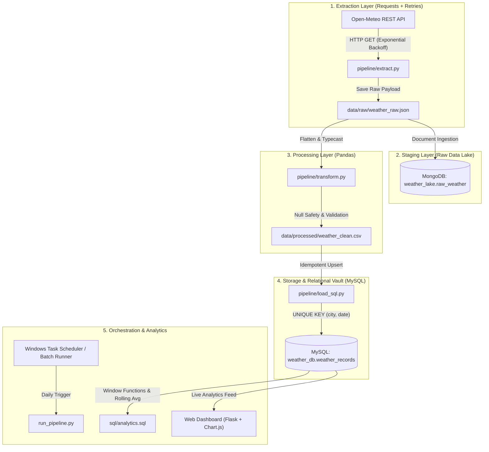

# 🌦️ SkyPulse: Production Weather ETL Data Pipeline & Analytics Center

An end-to-end, production-grade Data Engineering pipeline that extracts real-time meteorological observations across global cities, stages raw payloads in a Document Lake (MongoDB), transforms and type-cleans data using Pandas, and idempotently loads records into MySQL with duplicate-prevention constraints. Includes advanced SQL window analytics and an interactive web dashboard.

---

## 🏗️ Architecture & Dataflow



---

## 🌟 Key Features

* **Resilient Extraction**: Custom session using `urllib3` exponential backoff retries on status codes `429`, `500`, `502`, `503`, and `504`.
* **Raw Staging Lake**: Stores unadulterated JSON snapshots directly into **MongoDB** before processing (ELT / Data Lake architecture).
* **Strict Schema Transformation**: Normalizes nested JSON into flat 2D dataframes using **Pandas**, dropping corrupt timestamps, imputing nulls, and formatting standard `DATETIME` stamps.
* **Idempotent Database Loading**: Uses composite unique constraints `UNIQUE KEY (city, date)` and `INSERT ... ON DUPLICATE KEY UPDATE` in **MySQL**, guaranteeing that re-running the pipeline never duplicates records.
* **Advanced SQL Analytics**: Features SQL Window Functions (`ROW_NUMBER()`, `AVG(...) OVER (PARTITION BY ... ORDER BY ... ROWS BETWEEN 6 PRECEDING AND CURRENT ROW)`) for moving 7-day rolling averages and peak temperature rankings.
* **Production Reliability**: Centralized YAML configuration (`config/config.yaml`), environment secrets isolation (`.env`), rotating file logs (`logs/pipeline.log`), and 100% test pass rate with **Pytest**.
* **Interactive Web Dashboard**: Built with **Flask**, **Tailwind CSS**, and **Chart.js** displaying real-time city feeds, historical curves, and live database health metrics.

---

## 📂 Project Structure

```
python_pipline_project/
├── app/                        # Web Dashboard (Flask + UI)
│   ├── server.py               # Flask REST API backend
│   └── templates/
│       └── index.html          # Modern dark-mode dashboard (Tailwind + Chart.js)
├── config/
│   └── config.yaml             # Centralized pipeline configuration (cities, db, paths)
├── data/
│   ├── raw/                    # Raw JSON snapshots (gitignored)
│   └── processed/              # Clean tabular CSVs (gitignored)
├── logs/
│   └── pipeline.log            # Rotating application execution logs
├── pipeline/                   # Core Data Pipeline Modules
│   ├── utils/
│   │   ├── config.py           # Configuration & .env loader
│   │   └── logger.py           # Structured rotating file & console logger
│   ├── extract.py              # API extraction with exponential backoff
│   ├── store_mongo.py          # MongoDB raw document staging
│   ├── transform.py            # Pandas normalization & schema cleaning
│   ├── load_sql.py             # MySQL idempotent upsert loader
│   └── analytics.py            # Python SQL analytics runner
├── scripts/
│   ├── run_pipeline.bat        # Automated batch runner for Windows
│   └── register_windows_task.ps1 # Task Scheduler automated registration
├── sql/
│   ├── schema.sql              # MySQL DDL table definition & unique constraints
│   └── analytics.sql           # Aggregations, rankings & window functions
├── tests/
│   └── test_transform.py       # Pytest unit tests for transformation logic
├── .env.example                # Secrets template
├── .gitignore                  # Git hygiene rules
├── requirements.txt            # Dependency definitions
├── run_dashboard.py            # Dashboard launcher
├── run_pipeline.py             # Master pipeline orchestrator entrypoint
└── README.md                   # Project documentation
```

---

## 🚀 Quickstart Guide

### 1. Prerequisites
* Python 3.11+
* MySQL Server (running on `localhost:3306`)
* *(Optional)* MongoDB (running on `localhost:27017`)

### 2. Environment Configuration
Create a `.env` file in the project root (or copy `.env.example`):
```env
MYSQL_HOST=localhost
MYSQL_PORT=3306
MYSQL_USER=root
MYSQL_PASSWORD=your_mysql_password_here
MYSQL_DATABASE=weather_db
```

### 3. Run the Entire Pipeline
To execute the complete extraction, staging, transformation, loading, and verification in one command:
```powershell
python run_pipeline.py
```

### 4. Run SQL Analytics & Window Functions
```powershell
python pipeline/analytics.py
```

### 5. Launch the Web Dashboard
```powershell
python run_dashboard.py
```
Then visit **[http://localhost:5000](http://localhost:5000)** in your browser!

### 6. Run Automated Unit Tests
```powershell
python -m pytest tests/ -v
```

---

## 📊 SQL Analytics Showcase

### 7-Day Rolling Average Temperature (Moving Window)
```sql
SELECT 
    city,
    date,
    temperature AS daily_temp_c,
    ROUND(
        AVG(temperature) OVER (
            PARTITION BY city 
            ORDER BY date 
            ROWS BETWEEN 6 PRECEDING AND CURRENT ROW
        ), 2
    ) AS rolling_7day_avg_temp_c
FROM weather_records
ORDER BY city, date;
```

### Hottest Recorded Day per City (ROW_NUMBER Ranking)
```sql
WITH RankedWeather AS (
    SELECT 
        city,
        date,
        temperature,
        ROW_NUMBER() OVER (PARTITION BY city ORDER BY temperature DESC) AS temp_rank
    FROM weather_records
)
SELECT city, date, temperature AS peak_temperature_c
FROM RankedWeather
WHERE temp_rank = 1;
```

---

## ⏰ Windows Task Scheduler Automation

To automate daily ingestion every morning at 8:00 AM:
1. Open PowerShell as Administrator.
2. Run:
   ```powershell
   powershell -ExecutionPolicy Bypass -File scripts\register_windows_task.ps1
   ```
3. Execution logs will continuously append to `logs\scheduler.log`.

---

## 📜 12-Week Roadmap Progress (100% Complete)

* [x] **Weeks 1–2 (Extract)**: Requests, JSON parsing, function modularity, multi-city extraction.
* [x] **Weeks 3–4 (Transform)**: Pandas flattening, schema enforcement, null handling, CSV output.
* [x] **Weeks 5–6 (Load)**: Relational MySQL modeling, `(city, date)` composite unique keys, idempotent upserts.
* [x] **Week 7 (Raw Lake)**: MongoDB document store staging layer.
* [x] **Weeks 8–9 (Reliability)**: Rotating file logging, retry backoffs, centralized `config.yaml`, exception handling.
* [x] **Week 10 (Automate)**: Windows Task Scheduler automation and batch runner.
* [x] **Week 11 (Analyze)**: SQL Window Functions, 7-day rolling moving averages, ranking queries.
* [x] **Week 12 (Finish)**: Pytest unit test suites, interactive web dashboard, comprehensive README documentation.
